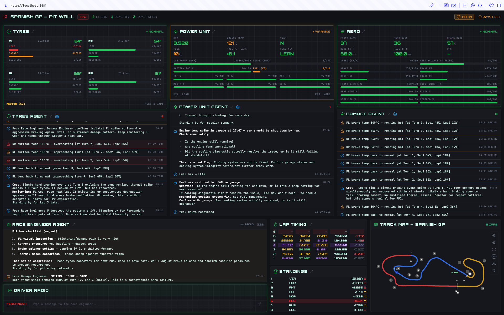

# Formula 1 racing team

<!-- TOC -->
* [Formula 1 racing team](#formula-1-racing-team)
  * [Setup](#setup)
  * [Tests](#tests)
  * [Docker](#docker)
  * [Telemetry](#telemetry)
  * [F1 Race Engineer Hub](#f1-race-engineer-hub)
    * [Race Engineer Hub UI](#race-engineer-hub-ui)
    * [Live telemetry](#live-telemetry)
    * [Capturing telemetry](#capturing-telemetry)
    * [Test data](#test-data)
    * [Replaying telemetry](#replaying-telemetry)
  * [Reinforcement Learning](#reinforcement-learning)
<!-- TOC -->

## Setup

Create a dedicated Python virtual environment:

```bash
python -m venv venv
```

Source it:

* For Windows:

  ```cmd
  .\venv\Scripts\activate.bat && set PYTHONPATH=%CD%
  ```

* For Mac:

  ```bash
  source venv/bin/activate && export PYTHONPATH=`pwd`
  ```

Install the requirements:

```bash
pip install -r requirements.txt
```

## Tests

Run the Python test suite from the repository root:

```bash
python -m pytest
```

CI runs it on every pull request and on pushes to `main`.

## Docker

Build and run the telemetry bridge and dashboard in one container:

```bash
docker compose up -d --build
```

Open [http://localhost:8081](http://localhost:8081) for the Race Engineer Hub. In F1 25, set
**Settings → Telemetry Settings** to send UDP to the host machine's IP on port **20777**.

Ports: `20777/udp` telemetry in, `8765/tcp` telemetry WebSocket, `8081/tcp` dashboard.

Configuration to edit:

* `data/` — `.f1bin` captures (bind-mounted).
* `docker-compose.yml` — uncomment a `command:` for replay mode,
  or set `build.args.VITE_WS_URL` to pin the WebSocket endpoint the UI connects to.

By default the dashboard connects to `ws://<the host serving the page>:8765`, so it works over
localhost or a LAN address without a rebuild. The image is published to
`ghcr.io/sechmachine727/f1`; a freshly created GHCR package is private, so flip its visibility in
the package settings if another machine needs to pull it anonymously.

## Telemetry

[EA F1 UDP specification](https://forums.ea.com/blog/f1-games-game-info-hub-en/ea-sports%E2%84%A2-f1%C2%AE25-udp-specification/12187347)

[F1 25 Telemetry Application (w/ PySide6)](https://github.com/Fredrik2002/f1-25-telemetry-application#)

Both packet formats are decoded: base F1 25 (packet format 2025, 22 car slots) and the
2026 Season Pack (packet format 2026, 24 car slots, plus the extra packet 16 "Car Telemetry 2").
The decoder picks the layout from the header's `m_packetFormat`, so the same server works with
either game version. A packet the decoder does not understand is logged and skipped instead of
stopping the telemetry stream.

Test listening to UDP packets:
```shell
python -m test_udp
```

Run a sample script to capture telemetry:
```shell
python -m telemetry_server --capture
```

## F1 Race Engineer Hub



1. The top panels report telemetry straight from the game
2. Under each telemetry panel, the 'alerts' are threshold warnings derived from that telemetry.
3. The Race Engineer panel collects driver radio messages and alert activity.
4. Contextual information like Lap Timing, Standings and live Track is also updated in real-time.


### Race Engineer Hub UI

In a terminal , start the web app:
```shell
cd race_engineer_hub
npm install
npm run dev
```

Open [http://localhost:8081](http://localhost:8081) in a browser to see the Race Engineer Hub UI. The panels will show "Waiting for telemetry…" until the F1 game starts sending UDP data on port 20777.

### Live telemetry

In another terminal, start the telemetry WebSocket bridge (streams live F1 25 UDP data to the web app):

```shell
python -m telemetry_server
```

> ⚠️ **Warning:** The F1 game must be configured to send telemetry to this server's IP address on UDP port 20777. In the game, go to **Settings → Telemetry Settings** and set the **IP Address** and **Port** to match the machine running the telemetry server.

### Capturing telemetry

Add `--capture` to save all telemetry to `.f1bin` binary files in `data/`. One file is created per session, rotating automatically on session change:
```shell
python -m telemetry_server --capture
```

### Test data

Optional test `.f1bin` telemetry files are stored as GitHub release assets (too large for git). Download them with:
```shell
./scripts/download_test_data.sh
```

You can also download them manually from the GitHub releases page and place them in `data/`.

### Replaying telemetry

Use `--replay` to play back a captured `.f1bin` file. The web app receives the data as if it were live:
```shell
python -m telemetry_server --replay data/f1_25_capture.f1bin
```

Add `--speed` to fast-forward the replay:
```shell
python -m telemetry_server --replay data/f1_25_capture.f1bin --speed 10x
```

## Reinforcement Learning

[Explainable Reinforcement Learning for Formula One Race Strategy](https://arxiv.org/abs/2501.04068)
